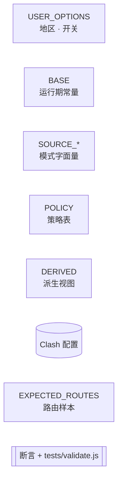

# Clash 完全覆写脚本

一个 Clash Party 覆写脚本，自动生成代理组、分流规则和 DNS 配置。

## 功能

- **声明式功能组**：国际媒体、Telegram、GitHub、微软服务、游戏平台、Apple 等，新增组只需加一条配置
- **地区自动检测**：根据订阅节点自动创建香港、美国、日本、新加坡、台湾、韩国等地区 url-test 组
- **AI Agent 策略组**：AI 域名和进程统一走独立策略组；有家宽出口时可选家宽 IP，无家宽出口时可直接选择订阅节点
- **家宽IP链路（可选）**：配置家宽出口后，可在 AI Agent 组中选择家宽 IP 出口
- **前置代理（可选）**：给订阅节点统一加一层国内云服务器跳板，缓解本机网络到订阅节点的污染和超时
- **自定义出口（可选）**：注入自定义 HTTP/SOCKS5 代理节点
- **GeoSite/GeoIP 兜底**：国内域名和 IP 自动直连，无需手动维护
- **跨平台进程规则**：同时覆盖 macOS 和 Windows 进程名

## 代理组结构

```
 1. 自动选择           ← url-test，自动选最快节点
 2. 节点选择           ← select，可选组/地区/裸节点/DIRECT
 3. GLOBAL            ← select，含节点选择 + 全部选项
 4. 🌍 国际媒体        ← YouTube/Netflix/Twitter/Disney+/Spotify 等
 5. 📲 Telegram       ← Telegram + Discord
 6. 🐙 GitHub         ← GitHub 全套
 7. Ⓜ️ 微软服务        ← Office/Azure/Bing/Xbox/VS Code 等
 8. 🎮 游戏平台        ← Steam/Epic/Nintendo/PlayStation/Blizzard
 9. 🍎 Apple          ← iCloud/App Store 等
10. 🎯 直连            ← DIRECT
11. 🤖 AI Agent       ← AI 域名/进程的独立出口选择组
12. 🔗 家宽跳板        ← 家宽节点的上级跳板（有家宽凭证时）
13. 🏠家宽IP          ← 家宽出口节点（有家宽凭证时）
14+ 地区 url-test 组   ← 🇭🇰|香港、🇺🇸|美国、🇯🇵|日本 等（沉底）
```

`🤖 AI Agent` 的成员会按是否配置家宽 IP 自动变化：

```
有家宽IP时：
  🏠家宽IP / 节点选择 / 地区组 / 自定义出口 / DIRECT

无家宽IP时：
  节点选择 / 地区组 / 自定义出口 / 订阅裸节点 / DIRECT
```

AI Agent 不直接放入总的自动选择组，避免 AI 出口选择过于含糊；地区组会保留。有家宽 IP 时不展开订阅裸节点，避免高阶场景下列表过长；无家宽 IP 时保留裸节点，方便单独给 AI 选择某个支持 AI 的订阅节点。

## 规则优先级

```
AI 进程规则           → 🤖 AI Agent
AI + 平台域名         → 🤖 AI Agent
浏览器进程规则        → 🤖 AI Agent（enableChainRegionBrowserProcessProxy 开启时）
功能组域名规则        → 各功能组（国际媒体/Telegram/GitHub/微软/游戏/Apple）
Tailscale 进程+IP    → DIRECT
国内域名/IP直连       → DIRECT（手动列表 + GEOSITE,cn + GEOIP,cn）
兜底                  → 节点选择
```

## 与 Tailscale 共存

脚本默认按标准 Tailscale 方式共存，不接管 Tailscale Exit Node 的转发流量。

保留直连的内容：

```text
Tailscale 进程 → DIRECT
100.64.0.0/10 → DIRECT
100.100.100.100/32 → DIRECT
fd7a:115c:a1e0::/48 → DIRECT
```

这样做是为了避免 Tailscale 的 WireGuard / DERP / MagicDNS 流量被 Clash 再代理一层，导致套娃或断联。

如果远程设备使用这台机器作为 Tailscale Exit Node，建议按 Tailscale 官方方式配置 Exit Node；本脚本不保证这类转发流量进入 Clash 规则。若远程设备也需要使用 Clash 分流，更稳定的方式是让远程设备通过 Tailscale 访问本机 Clash 的 HTTP/SOCKS 代理端口。

## 快速开始

### 1. 准备凭证文件（可选）

复制 [`出口IP凭证_样本.js`](src/出口IP凭证_样本.js)，重命名为 `出口IP凭证.js`，按需取消注释：

```javascript
function main(config) {
  // 家宽IP（可选）
  config._homeProxy = {
    type: "http",
    server: "你的家宽IP",
    port: 1080
  };

  // 自定义出口（可选，数组）
  config._customProxies = [
    { name: "自定义出口", type: "http", server: "10.0.0.1", port: 3128 }
  ];

  return config;
}
```

不配置任何凭证时，脚本仅做分流覆写（纯功能组 + 域名规则 + GeoSite/GeoIP 直连）。

如果你的本机网络到订阅节点经常超时，可以复制 [`前置代理_样本.js`](src/前置代理_样本.js)，重命名为 `前置代理.js`，配置一个上海/国内云服务器代理：

```javascript
function main(config) {
  config._frontProxy = {
    name: "上海阿里云前置",
    type: "socks5",
    server: "你的上海云服务器IP",
    port: 1080
  };

  return config;
}
```

配置后，订阅原始节点会先走这个前置代理；URLTest 测速地区节点时也会先走前置代理。自定义出口、家宽IP 和 DIRECT 不会被前置代理覆盖。

### 2. 导入覆写

在 Clash Party 覆写列表中按顺序导入：

1. `前置代理.js`（如有）
2. `出口IP凭证.js`（如有）
3. `完全覆写.js`

顺序不能反——覆写脚本需要读取凭证文件注入的配置。

### 3. 调整参数

覆写脚本顶部的可调参数：

```javascript
var USER_OPTIONS = {
  autoSelectGroupName: "自动选择",              // 订阅中自动选择组的名称
  enableChainRegionBrowserProcessProxy: false,  // 浏览器进程是否走家宽出口
  enableChainRegionAiCliProcessProxy: true      // AI CLI 进程是否走家宽出口
};
```

### 4. 启用并验证

- 启用覆写 → 切回订阅配置 → 启动代理
- 确认使用**规则模式**和 **TUN 模式**
- 打开 Clash Party 的「网络信息」，用不同检测源判断不同出口是否生效

网络信息检测源会被脚本显式分流：

| 检测源 | 用来判断什么 | 规则目标 | 预期结果 |
|---|---|---|---|
| `ipapi.is` | AI 专用出口 | `🤖 AI Agent` | 显示 AI Agent 当前选择的出口；如果选了 `🏠家宽IP`，就显示家宽 IP |
| `ipwho.is` | 普通代理出口 | `节点选择` | 显示常规代理节点出口，不受 AI Agent 单独选择影响 |
| `IP.SB` / `ip.sb` | 前置链路或直连出口 | 有前置代理时指向前置代理；无前置代理时 `DIRECT` | 开启前置代理时显示上海/国内云服务器 IP；未开启时显示本机直连公网 IP |

简单判定方式：

```text
ipapi.is   → 看 AI 相关流量最终走哪里
ipwho.is   → 看普通代理节点最终走哪里
ip.sb      → 看本机到订阅节点前的第一跳；没前置代理时就是直连公网 IP
```

如果配置了 `前置代理.js`，地区组和 URLTest 测速订阅节点时会先走前置代理，因此 `IP.SB` 应显示前置代理的 IP；但 `ipwho.is` 仍应显示普通代理节点的最终出口 IP。

## 文件说明

```
src/
  完全覆写.js           ← 覆写脚本（唯一）
  前置代理_样本.js       ← 前置代理样本（给订阅节点统一加第一跳）
  出口IP凭证_样本.js     ← 凭证样本（家宽IP + 自定义出口，全可选）
  家宽IP-链式代理.js     ← 原始脚本（保留参考）
  MiyaIP 凭证_样本.js    ← MiyaIP 凭证样本（保留参考）

tests/
  validate-direct.js    ← 测试用例
```

## 本地校验

```bash
node tests/validate-direct.js
```

## 覆盖的进程

### AI 应用（走 🤖 AI Agent）

以下应用和命令行工具会命中 `🤖 AI Agent`。如果 `🤖 AI Agent` 里选择了 `🏠家宽IP`，这些流量才会继续走家宽 IP；也可以按需切到地区组、自定义出口或订阅节点。

| 应用 | macOS | Windows |
|---|---|---|
| Claude | Claude, Claude Helper 等 | Claude.exe |
| Claude Code | Claude Code, claude | Claude Code.exe, claude.exe |
| ChatGPT | ChatGPT, ChatGPT Helper | ChatGPT.exe |
| Perplexity | Perplexity, Perplexity Helper | Perplexity.exe |
| Cursor | Cursor, Cursor Helper | Cursor.exe |
| Antigravity | Antigravity.app | Antigravity.exe, language_server_windows_x64.exe |
| Gemini CLI | gemini | gemini.exe |
| Codex CLI | codex | codex.exe |

### 浏览器（enableChainRegionBrowserProcessProxy 开启时走 🤖 AI Agent）

开启 `enableChainRegionBrowserProcessProxy` 后，以下浏览器进程会命中 `🤖 AI Agent`。默认关闭，避免普通浏览器流量过度影响 AI 出口选择。

| 浏览器 | macOS | Windows |
|---|---|---|
| Chrome | Google Chrome + Helper 系列 | chrome.exe |
| Edge | — | msedge.exe |
| Dia | Dia + Helper 系列 | Dia.exe |
| Atlas | Atlas + Helper 系列 | Atlas.exe |
| SunBrowser | SunBrowser + Helper 系列 | SunBrowser.exe |



- 运行环境：Clash Party 的 JavaScriptCore
- 语法范围：ES5
- 进程分流覆盖：macOS + Windows
