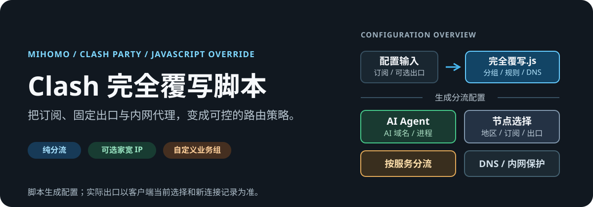
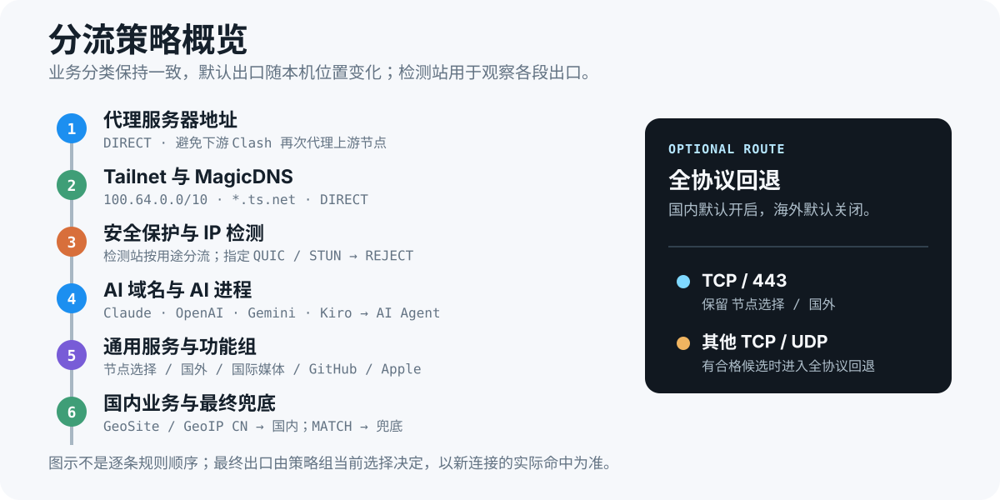

# Clash 完全覆写脚本

<p align="center">
  
</p>

<p align="center">
  <strong>给 Clash Party / Mihomo 的 JavaScript 覆写脚本。</strong><br>
  把订阅、前置代理、家宽 IP 和公司内网节点组合成一套可选择、可观察、可回退的路由策略。
</p>

<p align="center">
  <code>Clash Party</code> · <code>Mihomo</code> · <code>JavaScriptCore</code> · <code>macOS / Windows / Linux</code>
</p>

## 从这里开始

只想先让分流工作起来，不需要配置家宽 IP 或自定义节点：

1. 在 Clash Party 的覆写列表导入 [`src/完全覆写.js`](./src/完全覆写.js)。
2. 使用规则模式；需要接管应用流量时开启 TUN。
3. 打开代理组，在 `节点选择` 选一个正常节点；AI 相关服务则在 `🤖 AI Agent` 单独选择出口。

脚本会保留你的订阅节点，重建它管理的策略组、DNS 和规则。它不会把密码或凭证写入仓库；固定出口、前置代理与公司节点均放在单独的本地凭证脚本中。

> 详细的 Clash Party 操作、美国静态 IP、无订阅模式和排障步骤见 [低门槛配置教程](./docs/配置教程.md)。

## 它解决什么问题

- **把“节点”变成“策略”**：订阅节点自动组织为地区组、节点选择和功能组，AI 与普通出海可选不同出口。
- **把复杂出口留在可选层**：前置代理、家宽 IP、链式代理、公司内网节点和无订阅配置按需启用，不影响纯分流模式。
- **把流量路径做成可验证结果**：网络信息检测源、分组测速、连接图、规则顺序与本地测试分别覆盖不同层面。
- **让 Tailscale 与 TUN 共存**：Tailnet、MagicDNS 与出口节点转发保留在 Tailscale 的职责范围内，避免被 Clash 再代理。

## 流量如何决定

<p align="center">
  
</p>

脚本始终先处理明确且容易误路由的流量：

1. 代理服务器地址直连，避免局域网内多层 Clash 再代理订阅节点。
2. Tailnet 地址与 `*.ts.net` 保持 Tailscale 直连，MagicDNS 不进入 Fake-IP 或普通上游 DNS。
3. AI 域名的 UDP/443 与常见 WebRTC STUN UDP 被拒绝，浏览器会回退到 TCP，不把本地 UDP 出口暴露出去。
4. Claude、OpenAI、Gemini、AI Studio、Antigravity、Kiro、Perplexity、Mistral、xAI 及已覆盖的 AI 进程进入 `🤖 AI Agent`。
5. 开发服务、通用 Google 服务和未分类国际流量再进入 `节点选择` 或隐藏的 `🌐 通用出海`。
6. 国内域名/IP 最后按手动直连、GeoSite 与 GeoIP 直连；其余流量才进入最终兜底。

### 可选：全协议回退

`USER_OPTIONS.fullProtocolFallback` 默认开启。它只影响原本走 `节点选择`、`🌐 通用出海` 和最终 `MATCH` 的普通流量：

- TCP/443 仍使用当前 `节点选择` / `🌐 通用出海` 的选择结果，例如你手动选中的公司代理。
- HTTP、IMAP、其他 TCP 端口和 UDP 会进入隐藏的 `🔌 全协议回退`。
- 回退组只收录明确配置 `udp: true` 且完整链路均支持 UDP 的订阅节点或普通自定义出口；HTTP 家宽 IP、HTTP 公司代理，以及经过 HTTP 前置代理的节点不会被放入其中。
- 如果没有符合条件的节点，回退组不会生成，原有的 `节点选择` / `🌐 通用出海` 行为保持不变。
- AI Agent、AI DNS、AI QUIC、Tailnet 与已有功能组不使用回退组。

需要恢复旧逻辑时，在 `完全覆写.js` 顶部设置：

```javascript
fullProtocolFallback: false
```

## 选择你的模式

### 纯分流

只导入 `完全覆写.js`。适合已有订阅、希望按服务自动分流的日常场景。`🤖 AI Agent` 仍会出现；你可以从地区组、普通自定义出口、订阅裸节点或 `DIRECT` 中选择。

### 前置代理

复制 [`src/前置代理_样本.js`](./src/前置代理_样本.js) 为本地 `前置代理.js`，填写一级 HTTP 或 SOCKS5 代理，再排在主脚本之前。它只作为订阅原始节点的上游跳板；不会覆盖家宽 IP、自定义出口或 `DIRECT`。

### 家宽 IP 与链式代理

复制 [`src/出口IP凭证_样本.js`](./src/出口IP凭证_样本.js) 为本地 `出口IP凭证.js`，配置 `_homeProxy`。脚本会生成：

- `🏠 家宽IP`：真直连与可选链式家宽出口的选择组。
- `🔗 家宽跳板`：家宽链式节点使用的上游选择组。
- `🤖 AI Agent`：默认优先选择 `🏠 家宽IP`，同时保留普通节点选择。

### 无订阅与自定义出口

先导入 [`src/无订阅基础配置.yaml`](./src/无订阅基础配置.yaml)，再用 `出口IP凭证.js` 填写 `_customProxies`、`_homeProxy` 或自定义规则组。没有订阅时不会创建地区组或自动选择组；没有任何出口时脚本会直接报错，而不是生成不可用配置。

## 代理组模型

**日常可见的组**

- `节点选择`：默认普通代理出口，包含自动选择、地区组、普通自定义出口、订阅节点和 `DIRECT`。
- `GLOBAL`：全局模式的选择入口；有前置代理时可在这里显式选择它。
- `🤖 AI Agent`：AI 域名与 AI 应用的独立出口选择。
- `🌍 国际媒体`、`📲 Telegram`、`🐙 GitHub`、`Ⓜ️ 微软服务`、`🎮 游戏平台`、`🍎 Apple`、`🎯 直连`：按业务拆分的策略组。
- `🏠 家宽IP`、`🔗 家宽跳板`：仅在配置家宽 IP 时出现。

**隐藏的内部组**

- `🌐 通用出海`：让最终国际流量复用 `节点选择`，不作为额外入口展示。
- `🔌 全协议回退`：可选的非 443 / UDP 出口能力组。
- `🇯🇵 日本服务`：LINE、Yahoo Japan、Sony、Nintendo 等优先日本节点的内部组。
- `🧩 Tailnet 内部直连`、`🧩 Tailscale 控制面`、`🧩 Tailscale 进程`：默认隐藏，排障时可临时显示。

`scope: "dedicated"` 的公司代理不会进入任何通用组。它必须由 `_customRuleGroups` 明确引用，例如只让 `*.corp.example` 或 `10.0.0.0/8` 使用；这样公司网络不会意外成为普通出海出口。

## AI、DNS 与隐私边界

### AI Agent

AI 服务与普通 Google/YouTube 分开处理：YouTube 共享 API 优先进入国际媒体，通用 Google 服务进入节点选择，Gemini、AI Studio、Antigravity 与 Kiro 明确进入 `🤖 AI Agent`。这避免“为了 AI 把整站 Google 都送进家宽出口”。

当 `rejectAiQuic: true` 时，每一个 AI 域名都会生成一条 UDP/443 `REJECT` 规则，再匹配对应的 TCP/HTTPS AI 规则。对于不支持 UDP 的 HTTP 固定出口，这是防止回退到直连的必要边界。

### DNS

海外和未知域名的 DoH 默认通过 `🤖 AI Agent` 建立连接，国内域名、直连域名和代理服务器解析则使用国内 DNS。DNS 检测页显示的是递归 DNS 提供商的地址，不会等于家宽出口 IP；关键判断是海外解析是否仍显示中国大陆递归 DNS。

不要同时开启 Clash Party 独立的「DNS 覆写」作为第二个配置入口。它可能在主脚本之后覆盖 `respect-rules`、上游 DNS 与策略路由。

### Tailscale

默认配置保留 `100.64.0.0/10`、`100.100.100.100/32`、Tailnet IPv6 前缀和 `*.ts.net` 的直连路径，并排除 TUN 路由。Tailscale 控制面和进程默认 `DIRECT`，但可通过 `USER_OPTIONS.tailscale` 改为前置代理或节点选择。

Exit Node 转发流量默认继续使用正常分流规则。只有明确要把 Exit Node 转发流量强制指定到某个目标时，才开启 `forceExitNodeTraffic`。

## 导入顺序

按需导入，主脚本始终放在最后：

```text
前置代理.js        （可选）
出口IP凭证.js      （可选）
自定义规则组.js    （可选）
完全覆写.js        （必选）
```

前面的文件只把配置对象注入当前环境；`完全覆写.js` 读取这些对象后统一生成代理节点、策略组、DNS、TUN 与规则。样本文件可安全复制为本地文件，仓库不会保存你的代理地址、用户名或密码。

## 验证是否真的生效

不同检测源对应不同链路，不能互相替代：

| 检测源 | 观察的策略 | 正确用途 |
|---|---|---|
| `ip.net.coffee` | `🤖 AI Agent` | 观察 AI 出口、DNS、协议和端到端表现 |
| `ipapi.is` | `🤖 AI Agent` | 确认 AI 最终出口 IP |
| `ipwho.is` | `节点选择` | 确认普通代理最终出口 |
| `ip.sb` | 前置代理或 `DIRECT` | 确认订阅节点前的第一跳 |

在 Clash Party 中结合三处信息判断：

1. 代理组当前选择与测速。
2. 网络信息页的 IP、地区、DNS 与 WebRTC 结果。
3. 连接图或 Mihomo 日志中的实际规则命中。

脚本能生成规则，但只有重新导入/重载覆写并查看当前运行配置后，才能证明客户端已经生效。

## 本地校验

```bash
node --check src/完全覆写.js
node tests/validate-direct.js
node tests/validate.js
python3 -m py_compile scripts/proxy-reliability-test.py
node scripts/check-claude-rules.js
```

`check-claude-rules.js` 会把当前 Claude/Anthropic 规则与参考页的具体域名、CIDR 比对。关键词、ASN 和 GeoSite 建议只输出提示，不会自动扩大匹配范围。

对家宽 IP、公司代理或自定义 HTTP/SOCKS5 出口，可使用 [`scripts/proxy-reliability-test.py`](./scripts/proxy-reliability-test.py) 独立压测连通率与延迟；它验证代理本身，不替代 Clash 的规则命中检查。

## 文件地图

```text
src/
  完全覆写.js             主覆写脚本
  前置代理_样本.js         订阅节点的一级前置代理
  出口IP凭证_样本.js       家宽 IP、普通出口、dedicated 公司代理
  自定义规则组_样本.js     固定域名或网段的独立策略组
  无订阅基础配置.yaml      无订阅模式的空配置容器

tests/
  validate-direct.js       主覆写行为与回归测试
  validate.js              原始链式代理脚本的兼容性测试

scripts/
  update-interface-name.js 自动探测并写入 Tailscale 网卡名
  proxy-reliability-test.py 批量测试出口代理稳定性
  check-claude-rules.js    检查 Claude/Anthropic 域名与 CIDR 覆盖

docs/
  配置教程.md              面向首次使用者的完整操作说明
```

`src/家宽IP-链式代理.js` 与 `src/MiyaIP 凭证_样本.js` 是历史参考脚本，不是当前推荐入口。新配置使用 `出口IP凭证.js` 加 `完全覆写.js`。

## 进一步阅读

- [低门槛配置教程](./docs/配置教程.md)：逐步导入、无订阅、前置代理、家宽 IP、公司内网和 Tailscale。
- [出口凭证样本](./src/出口IP凭证_样本.js)：本地出口配置的唯一入口。
- [自定义规则组样本](./src/自定义规则组_样本.js)：把指定业务域名与网段固定指向某个专用节点。
