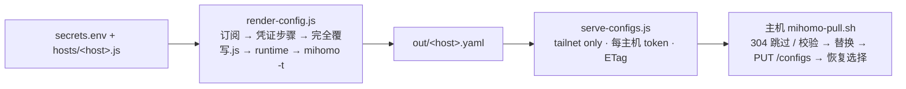

# Clash 完全覆写脚本

<p align="center">
  
</p>

<p align="center">
  <strong>给 Clash Party / Mihomo 的 JavaScript 覆写脚本。</strong><br>
  把订阅、前置代理、家宽 IP 和公司内网节点组合成一套可选择、可观察、可回退的路由策略。
</p>

<p align="center">
  <code>Clash Party</code> · <code>Mihomo</code> · <code>JavaScriptCore</code> · <code>macOS / Windows / Linux</code>
</p>

## 从这里开始

> 多台机器、或不想安装 Clash Party：默认用 [headless 渲染 + 主机拉取](#默认工作流headless-渲染--主机拉取不需要-clash-party)，一台主机渲染，各主机 mihomo 内核自己拉取并热重载。下面是单机在 Clash Party 里直接导入脚本的用法。

只想先让分流工作起来，不需要配置家宽 IP 或自定义节点：

1. 在 Clash Party 的覆写列表导入 [`src/完全覆写.js`](./src/完全覆写.js)。
2. 使用规则模式；需要接管应用流量时开启 TUN。
3. 打开代理组，在 `节点选择` 选一个正常节点；AI 相关服务则在 `🤖 AI Agent` 单独选择出口。

脚本会保留你的订阅节点，重建它管理的策略组、DNS 和规则。它不会把密码或凭证写入仓库；固定出口、前置代理与公司节点均放在单独的本地凭证脚本中。

> 详细的 Clash Party 操作、美国静态 IP、无订阅模式和排障步骤见 [低门槛配置教程](./docs/配置教程.md)。

## 它解决什么问题

- **把“节点”变成“策略”**：订阅节点自动组织为地区组、节点选择和功能组，AI 与普通出海可选不同出口。
- **把复杂出口留在可选层**：前置代理、家宽 IP、链式代理、公司内网节点和无订阅配置按需启用，不影响纯分流模式。
- **把流量路径做成可验证结果**：网络信息检测源、分组测速、连接图、规则顺序与本地测试分别覆盖不同层面。
- **让 Tailscale 与 TUN 共存**：Tailnet、MagicDNS 与出口节点转发保留在 Tailscale 的职责范围内，避免被 Clash 再代理。

## 流量如何决定

<p align="center">
  
</p>

脚本始终先处理明确且容易误路由的流量：

1. 代理服务器地址直连，避免局域网内多层 Clash 再代理订阅节点。
2. Tailnet 地址与 `*.ts.net` 保持 Tailscale 直连，MagicDNS 不进入 Fake-IP 或普通上游 DNS。
3. AI 域名的 UDP/443 与常见 WebRTC STUN UDP 被拒绝，浏览器会回退到 TCP，不把本地 UDP 出口暴露出去。
4. Claude、OpenAI、Gemini、AI Studio、Antigravity、Kiro、Perplexity、Mistral、xAI 及已覆盖的 AI 进程进入 `🤖 AI Agent`。
5. 开发服务、通用 Google 服务和明确的境外域名再进入 `节点选择` 或 `🌐 国外`。
6. 国内域名/IP（少量显式例外、GeoSite 与 GeoIP）进入 `🇨🇳 国内`；其余流量由最后一条 `MATCH,🐟 兜底` 决定走国内还是国外。

国内直连以 Mihomo 的 `GEOSITE,cn` 和 `GEOIP,cn` 为主，不重复维护腾讯、阿里、WPS 等整套域名清单。脚本只显式保留 `rivotek.com`、`larksuite.com`、`larkoffice.com`、`dashscope.aliyuncs.com`、`feishu.net`、`feishucdn.com`、`dingtalkapps.com` 和 `typeless.com`，用于提前兜底或指定合适的 DNS；其中 `typeless.com` 使用海外 DNS，但业务流量仍保持直连。

### 可选：全协议回退

`USER_OPTIONS.fullProtocolFallback` 默认开启。它只影响原本走 `节点选择`、`🌐 国外` 的普通流量（cn 下 `🐟 兜底` 也多一个 `🔌 全协议回退` 候选）：

- TCP/443 仍使用当前 `节点选择` / `🌐 国外` 的选择结果，例如你手动选中的公司代理。
- HTTP、IMAP、其他 TCP 端口和 UDP 会进入隐藏的 `🔌 全协议回退`。
- 回退组只收录明确配置 `udp: true` 且完整链路均支持 UDP 的订阅节点或普通自定义出口；HTTP 家宽 IP、HTTP 公司代理，以及经过 HTTP 前置代理的节点不会被放入其中。
- 如果没有符合条件的节点，回退组不会生成，原有的 `节点选择` / `🌐 国外` 行为保持不变。
- AI Agent、AI DNS、AI QUIC、Tailnet 与已有功能组不使用回退组。

需要恢复旧逻辑时，在 `完全覆写.js` 顶部设置：

```javascript
fullProtocolFallback: false
```

## 选择你的模式

### 纯分流

只导入 `完全覆写.js`。适合已有订阅、希望按服务自动分流的日常场景。`🤖 AI Agent` 仍会出现；你可以从地区组、普通自定义出口、订阅裸节点或 `DIRECT` 中选择。

### 前置代理

复制 [`src/前置代理_样本.js`](./src/前置代理_样本.js) 为本地 `前置代理.js`，填写一级 HTTP 或 SOCKS5 代理，再排在主脚本之前。它只作为订阅原始节点的上游跳板；不会覆盖家宽 IP、自定义出口或 `DIRECT`。

### 家宽 IP 与链式代理

复制 [`src/出口IP凭证_样本.js`](./src/出口IP凭证_样本.js) 为本地 `出口IP凭证.js`，配置 `_homeProxy`。脚本会生成：

- `🏠 家宽IP`：真直连与可选链式家宽出口的选择组。
- `🔗 前置`：`DIRECT` + 本机可直连节点组成的固定选择组（select，不自动跳变；默认 `DIRECT`），家宽链式节点和其它“需中转”节点都经它连接。
- `🤖 AI Agent`：默认优先选择 `🏠 家宽IP`，同时保留普通节点选择。

### 无订阅与自定义出口

先导入 [`src/无订阅基础配置.yaml`](./src/无订阅基础配置.yaml)，再用 `出口IP凭证.js` 填写 `_customProxies`、`_homeProxy` 或自定义规则组。没有订阅时不会创建地区组或自动选择组；没有任何出口时脚本会直接报错，而不是生成不可用配置。

## 代理组模型

**日常可见的组**

- `节点选择`：默认普通代理出口，包含自动选择、地区组、普通自定义出口、订阅节点和 `DIRECT`。
- `自动选择`默认过滤订阅状态信息和名称含“公司代理”的节点；被过滤节点仍保留在`节点选择`中供手动使用，可通过 `USER_OPTIONS.autoSelectExcludeKeywords` 调整。
- `GLOBAL`：全局模式的选择入口；有前置代理时可在这里显式选择它。
- `🤖 AI Agent`：AI 域名与 AI 应用的独立出口选择。
- `🌍 国际媒体`、`📲 Telegram`、`🐙 GitHub`、`Ⓜ️ 微软服务`、`🎮 游戏平台`、`🍎 Apple`、`🎯 直连`：按业务拆分的策略组。
- `🇨🇳 国内`、`🌐 国外`、`🐟 兜底`：位置无关的三个策略组，规则对所有主机相同，只有默认选项随 `location` 变（见下文）。
- 节点组段：`🏠 家宽IP`（配置家宽 IP 时）、`🔗 前置`、地区 url-test 组。

**隐藏的内部组**

- `🔌 全协议回退`：可选的非 443 / UDP 出口能力组。
- `🇯🇵 日本服务`：LINE、Yahoo Japan、Sony、Nintendo 等优先日本节点的内部组。
- `🧩 Tailnet 内部直连`、`🧩 Tailscale 控制面`、`🧩 Tailscale 进程`：默认隐藏，排障时可临时显示。

`scope: "dedicated"` 的公司代理不会进入任何通用组。它必须由 `_customRuleGroups` 明确引用，例如只让 `*.corp.example` 或 `10.0.0.0/8` 使用；这样公司网络不会意外成为普通出海出口。

自定义业务规则可以覆盖普通服务分类，但不能覆盖代理服务器直连、Tailnet 基础路由、Google/AI 一致性及 QUIC/WebRTC 防泄漏规则。出现同类型、同匹配值的冲突时，脚本会直接指出冲突规则并停止生成配置。

节点与代理组的名称必须全局唯一，自定义配置不能覆盖同名订阅节点或受管组。脚本会在全部组创建后检查显式成员和 `dialer-proxy` 的引用，缺失出口和循环链路会显示具体路径。

## AI、DNS 与隐私边界

### IPv6 开关

`完全覆写.js` 顶部的 `USER_OPTIONS.enableIPv6` 默认是 `false`，生成配置时同时设置全局 `ipv6: false` 和 `dns.ipv6: false`，覆盖订阅原有值。需要启用时改为 `true`，两项会同步开启。该开关适用于订阅和无订阅模式，控制 Mihomo 配置；系统网卡和 Tailscale 的 IPv6 设置由各自管理。

修改后重新加载覆写，检查实际配置中的这两项是否一致。

### 社区规则与增量维护

AI、国际媒体、Telegram/Discord 和 GitHub 的基础域名来自社区维护清单，更新时固定上游提交并内嵌到脚本。Muse / Meta AI、Llama、Microsoft Copilot 和 GitHub Copilot 优先进入 `🤖 AI Agent`；普通 Facebook、Instagram、WhatsApp、YouTube 继续使用 `🌍 国际媒体`。精确域名不会自动扩大为后缀，共享登录、CDN 和遥测按记录中的策略处理。

来源、过滤理由、这次调查的证据与后续步骤见 [规则维护与调研记录](./docs/规则维护与调研记录.md)。维护流程：

```bash
node scripts/sync-community-rules.js --dry-run
node scripts/sync-community-rules.js --refresh
node scripts/sync-community-rules.js --check
node tests/validate-community.js
node tests/validate-direct.js
```

离线或仅调整本地分类策略时使用 `--render`。不要手工修改主脚本中的生成区段；工具会记录每次规则增删和上游版本。

### AI Agent

Google 账号与 AI 服务默认使用统一出口：Gemini、AI Studio、Antigravity、账号登录和其余 Google 服务进入 `🤖 AI Agent`；YouTube 内容、Google Play 和 FCM 则按媒体与协议能力优先分流，Kiro 等非 Google AI 服务继续使用各自的精确规则。

Codex CLI 的 `codex` 与桌面端后台进程 `Codex (Service)` 都固定进入 `🤖 AI Agent`，避免同一桌面会话因请求域名不同而分散到 GitHub、Google 或通用出海出口。

Sentry、Datadog、Intercom、Statsig、Stripe、WorkOS、SendGrid 等共享基础设施不再凭域名全局进入 AI Agent。AI 桌面应用与 CLI 仍由进程规则覆盖，其他应用访问同一基础设施时按普通业务规则处理。

`USER_OPTIONS.googleTrafficConsistency` 默认开启。脚本使用 Mihomo 内置的 `GEOSITE,google-deepmind` 和 `GEOSITE,google` 补齐 Google 账号、Gemini、Antigravity 等共享端点，并统一到 `🤖 AI Agent`；YouTube、Google Play 和 FCM 仍优先进入国际媒体或全协议出口。这样登录与 AI 请求保持同一出口，同时避免 Play 长连接和视频流量误走仅支持 HTTP 的家宽节点。设为 `false` 可恢复原来的精确域名分流。

当 `rejectAiQuic: true` 时，每一个 AI 域名都会生成一条 UDP/443 `REJECT` 规则，再匹配对应的 TCP/HTTPS AI 规则。对于不支持 UDP 的 HTTP 固定出口，这是防止回退到直连的必要边界。

当 `rejectAppStoreQuic: true` 时，App Store 启动接口 `bag.itunes.apple.com` 的 UDP/443 会被拒绝，促使 macOS 回退到 HTTPS/TCP。该规则不改变 `🍎 Apple` 的出口选择，也不影响 iCloud 或 Apple Push。

### DNS

海外和未知域名的 DoH 默认通过 `🤖 AI Agent` 建立连接，国内域名、直连域名和代理服务器解析则使用国内 DNS。DNS 检测页显示的是递归 DNS 提供商的地址，不会等于家宽出口 IP；关键判断是海外解析是否仍显示中国大陆递归 DNS。

电脑或云主机在境外时，把 `USER_OPTIONS.location` 改为 `overseas`：`🇨🇳 国内` 默认改选回国出口（成员来自 `domesticExit`，例如一台国内 VPS），`🌐 国外` 与 `🐟 兜底` 默认直连/国外，DNS 也换成本机直连的境外 DoH。默认 `cn` 的输出保持不变，详见[配置教程](docs/配置教程.md#境外使用location)。

| 策略组 | 谁指向它 | cn 默认 | overseas 默认 |
|---|---|---|---|
| `🇨🇳 国内` | 国内例外域名、`GEOSITE,cn`、`GEOIP,cn` | `DIRECT` | `domesticExit` 第一个（如 阿里云回国） |
| `🌐 国外` | 明确的境外域名 | `节点选择` | `DIRECT` |
| `🐟 兜底` | 最后一条 `MATCH` | `🇨🇳 国内` | `🌐 国外` |

三个组都是手动选择组，候选一直都在，可随时切换。

**🔗 前置**：节点只按“本机能不能直连”分两类。`USER_OPTIONS.relay.excludePorts` 端口上的节点（例如出口拦截 443 的云主机）视为需中转：自定义节点和家宽IP 自动 `dialer-proxy` 到 `🔗 前置`，自身不进前置候选；节点也可写 `via: "名称"` 指定专门的前置。其余可直连的订阅节点、自定义节点（alivps、公司代理……）都是 `🔗 前置` 的候选（`relay.excludeKeywords` 可过滤高倍率节点）。`🔗 前置` 是固定选择、不测速跳变，代码默认 `DIRECT`（即不走前置）；本机直连不了需中转节点时（如出口拦截 443），在主机 `selections` 里固定一个可直连节点。

不要同时开启 Clash Party 独立的「DNS 覆写」作为第二个配置入口。它可能在主脚本之后覆盖 `respect-rules`、上游 DNS 与策略路由。

### Tailscale

默认配置保留 `100.64.0.0/10`、`100.100.100.100/32`、Tailnet IPv6 前缀和 `*.ts.net` 的直连路径，并排除 TUN 路由。Tailscale 控制面和进程默认 `DIRECT`，但可通过 `USER_OPTIONS.tailscale` 改为前置代理或节点选择。

Exit Node 转发流量默认继续使用正常分流规则。只有明确要把 Exit Node 转发流量强制指定到某个目标时，才开启 `forceExitNodeTraffic`。

## 默认工作流：headless 渲染 + 主机拉取（不需要 Clash Party）

一台渲染主机持有秘密，按主机文件为每台机器渲染一份通用 mihomo 配置；各主机的 mihomo 内核通过 tailnet 拉取自己的那一份并热重载。Clash Party 变为可选的查看器，或继续按下文「导入顺序」自己跑覆写。



```bash
npm install
cp secrets.env.example secrets.env && chmod 600 secrets.env
cp hosts/overseas-cloud.example.js hosts/myhost.js
node scripts/render-config.js --host myhost            # out/myhost.yaml，自动 mihomo -t
node scripts/serve-configs.js --listen 100.x.y.z:7898  # 渲染主机的 tailnet IP
# 目标主机：
mihomo-pull.sh /etc/mihomo-pull.env                    # 配合 examples/systemd 的 timer 或 cron
```

完整说明（主机文件字段、回滚与选择恢复、安全边界）见 [docs/headless-render.md](./docs/headless-render.md)。

## 导入顺序

按需导入，主脚本始终放在最后：

```text
前置代理.js        （可选）
出口IP凭证.js      （可选）
自定义规则组.js    （可选）
完全覆写.js        （必选）
```

前面的文件只把配置对象注入当前环境；`完全覆写.js` 读取这些对象后统一生成代理节点、策略组、DNS、TUN 与规则。样本文件可安全复制为本地文件，仓库不会保存你的代理地址、用户名或密码。

## 验证是否真的生效

不同检测源对应不同链路，不能互相替代：

| 检测源 | 观察的策略 | 正确用途 |
|---|---|---|
| `ip.net.coffee` | `🤖 AI Agent` | 观察 AI 出口、DNS、协议和端到端表现 |
| `ipapi.is` | `🤖 AI Agent` | 确认 AI 最终出口 IP |
| `ipwho.is` | `节点选择` | 确认普通代理最终出口 |
| `ip.sb` | 前置代理或 `DIRECT` | 确认订阅节点前的第一跳 |

在 Clash Party 中结合三处信息判断：

1. 代理组当前选择与测速。
2. 网络信息页的 IP、地区、DNS 与 WebRTC 结果。
3. 连接图或 Mihomo 日志中的实际规则命中。

脚本能生成规则，但只有重新导入/重载覆写并查看当前运行配置后，才能证明客户端已经生效。

## 本地校验

```bash
node --check src/完全覆写.js
node tests/validate-direct.js
node tests/validate.js
node tests/validate-community.js
node tests/validate-headless.js        # 需先 npm install
node scripts/sync-community-rules.js --check
python3 -m py_compile scripts/proxy-reliability-test.py
node scripts/check-claude-rules.js
```

`check-claude-rules.js` 会把当前内嵌 AI 规则和本地 Anthropic 补充与参考页的具体域名、CIDR 比对，保留精确/后缀匹配的区别。关键词、ASN 和 GeoSite 建议只输出提示，不会自动扩大匹配范围。

对家宽 IP、公司代理或自定义 HTTP/SOCKS5 出口，可使用 [`scripts/proxy-reliability-test.py`](./scripts/proxy-reliability-test.py) 独立压测连通率与延迟；它验证代理本身，不替代 Clash 的规则命中检查。

## 文件地图

```text
src/
  完全覆写.js             主覆写脚本
  前置代理_样本.js         订阅节点的一级前置代理
  出口IP凭证_样本.js       家宽 IP、普通出口、dedicated 公司代理
  自定义规则组_样本.js     固定域名或网段的独立策略组
  无订阅基础配置.yaml      无订阅模式的空配置容器

tests/
  validate-direct.js       主覆写行为与回归测试
  validate.js              原始链式代理脚本的兼容性测试
  validate-community.js    社区解析、分类边界与增量更新测试
  validate-headless.js     headless 渲染器回归（URI 解析、字段透传、runtime、ETag 稳定）

scripts/
  render-config.js         headless 渲染：每台主机一份 mihomo 配置（不需要 Clash Party）
  serve-configs.js         tailnet 配置发布器（每主机 token、ETag/304）
  mihomo-pull.sh           主机侧拉取、校验、热重载、回滚、恢复选择
  lib/proxy-uri.js         代理 URI 解析（http/socks5/ss/vless/trojan/hy2）
  update-interface-name.js 自动探测并写入 Tailscale 网卡名
  proxy-reliability-test.py 批量测试出口代理稳定性
  check-claude-rules.js    检查 Claude/Anthropic 域名与 CIDR 覆盖
  sync-community-rules.js 社区快照同步、规则生成与增量记录
  rule-routing-audit.js   显式规则首条命中的离线检查

rules/
  community-sources.json  来源、分类策略、过滤理由与边界样例
  community.snapshot.json 固定上游版本的完整规则快照
  community-update-history.json 追加式更新历史

hosts/
  *.example.js             主机文件样例（真实 hosts/*.js 不进 git）

examples/                  mihomo-pull 的 systemd timer、cron 与 env 样例

docs/
  headless-render.md       默认工作流：渲染 → 发布 → 拉取 → 热重载
  配置教程.md              面向首次使用者的完整操作说明
  规则维护与调研记录.md    调查证据与后续增量维护步骤
```

`src/家宽IP-链式代理.js` 与 `src/MiyaIP 凭证_样本.js` 是历史参考脚本，不是当前推荐入口。新配置使用 `出口IP凭证.js` 加 `完全覆写.js`。

## 进一步阅读

- [低门槛配置教程](./docs/配置教程.md)：逐步导入、无订阅、前置代理、家宽 IP、公司内网和 Tailscale。
- [规则维护与调研记录](./docs/规则维护与调研记录.md)：社区来源、服务分类边界、更新工具和本次调查结果。
- [出口凭证样本](./src/出口IP凭证_样本.js)：本地出口配置的唯一入口。
- [自定义规则组样本](./src/自定义规则组_样本.js)：把指定业务域名与网段固定指向某个专用节点。
