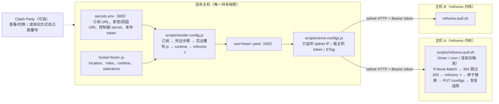

# 默认工作流：一次渲染 → 每台主机一份 mihomo 配置 → 主机拉取 → 热重载

> 不需要 Clash Party。Clash Party 仍可用来查看、手动切换节点，或直接按原方式导入覆写脚本；它不再是必需项。



## 1. 渲染主机

```bash
npm install                                   # 只依赖 yaml
cp secrets.env.example secrets.env && chmod 600 secrets.env   # 填订阅 URL、出口 URI、各主机 token
cp hosts/overseas-cloud.example.js hosts/myhost.js            # 每台主机一份；不进 git
node scripts/render-config.js --host myhost    # 或 --all；输出 out/myhost.yaml（600），默认跑 mihomo -t
node scripts/serve-configs.js --listen <本机 tailnet IP>:7898
```

- 渲染顺序与 Clash Party 一致：先「凭证步骤」（主机文件 + secrets 生成 `_homeProxy` / `_frontProxy` / `_customProxies` / `_customRuleGroups`），再执行 `src/完全覆写.js` 的 `main(config)`。
- 每台主机的 `location`、`domesticExit`（由 `roles.cnReturn` 生成）、`options` 在渲染时覆盖 `USER_OPTIONS`，不再修改共享脚本。
- 出口可写 `{ name, secret: "KEY" }`、`{ name, uri: "ss://…" }` 或完整 mihomo 节点；协议字段（ss 的 cipher、vless 的 uuid/reality 等）完整透传。`optional: true` 时缺 secret 跳过。
- `roles.relay` 可对 `🔗 家宽跳板` 排序：`prefer`（正则）、`excludePorts`。
- `roles.front` 生成 `_frontProxy` 节点，成为 `🔗 前置` 的第一个候选并默认选中；不写时 `🔗 前置` 默认 `DIRECT`（订阅节点仍挂在它上面，可在面板随时切换）。
- `options.front`（→ `USER_OPTIONS.front`）过滤 `🔗 前置` 的候选副本 `⤴ 原名`：`excludePorts`、`excludeKeywords`、`prefer`。
- `runtime` 决定监听端口、`bind-address`、`allow-lan`、控制器地址与 secret、TUN 开关；渲染器会去掉订阅里的其它监听项。
- `selections` 写入配置头部注释 `# cocp-selections:`，主机首次拉取或旧选择失效时套用。
- 同样输入产生同样字节，ETag 只在内容变化时改变。日志只打印 secret 的 KEY，不打印值。

## 2. 主机侧

```bash
install -m 755 scripts/mihomo-pull.sh /usr/local/bin/
install -m 600 examples/mihomo-pull.env.example /etc/mihomo-pull.env   # 填 PULL_URL、PULL_TOKEN、MIHOMO_DIR …
mihomo-pull.sh /etc/mihomo-pull.env
# 定时：examples/systemd/mihomo-pull.{service,timer}，或 cron：*/5 * * * * /usr/local/bin/mihomo-pull.sh /etc/mihomo-pull.env
```

`mihomo-pull.sh` 的行为：

1. 带 `If-None-Match` 拉取；`304` 直接退出。
2. `mihomo -t` 校验失败：丢弃下载，保留现有配置。
3. 通过：备份旧文件，原子替换，`PUT /configs?force=true` 热重载（用旧配置里的 secret 访问控制器）。
4. 重载失败或重载后控制器不可达：回滚旧文件并再次重载。
5. 成功后恢复重载前每个 Selector 的选择；旧选择不存在时用 `# cocp-selections` 默认值。
6. 内核未运行时只写入文件，下次启动生效。`--apply-selections` 只把默认选择套到运行中的内核。

## 3. 安全边界

- 秘密只在渲染主机：`secrets.env`、`hosts/*.js`、`out/` 都在 `.gitignore`。
- 发布器拒绝监听非 tailnet / 回环地址（除非显式 `--allow-any-address`）；每台主机一个 token，A 的 token 拿不到 B 的配置；没有 token 的主机返回 404。
- 生成的配置含节点凭证，文件权限 600，只经 tailnet 传输。

## 4. 与 Clash Party 的关系

- 想继续用 Clash Party：按原「导入顺序」把脚本导入覆写列表即可，行为不变。
- 想用 Clash Party 查看 headless 生成的配置：在它里面新建远程订阅，地址填发布器 URL（需带 token 的客户端）或直接导入 `out/<host>.yaml` 为本地配置；此时不要再叠加覆写脚本。
