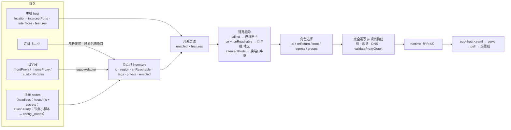

# 统一节点清单设计（设计稿，未实现）

> 状态：设计稿 · 2026-10-17 · 基于 `feat/headless-render`（PR #2）· 先评审，暂不改 `完全覆写.js`
> 关系：取代 [出口角色设计.md](./出口角色设计.md) 中的 `_exits` / `roles` 写法；默认流程仍是 headless 渲染 + 主机拉取（[headless-render.md](./headless-render.md)），Clash Party 可选。

## 1. 目标

1. **只有一个节点池**：`_frontProxy`、`_homeProxy`、`_customProxies` 和订阅节点放进同一份清单 `nodes`。
2. **用属性描述节点，不用写死的名字**：每个节点写明地区、能不能从大陆直连、标签和是否私有。角色按选择器从池里挑节点。
3. **自动推导链路**：要不要套一跳由「主机环境 + 节点属性」算出来，`家宽IP链式` 这种特例去掉。
4. **开关不丢**：节点级 `enabled` 加主机级 `features`，保留 Clash Party「全局启用」按文件切换的习惯。
5. **兼容旧写法**：旧的三个注入字段自动转成节点，现有本地脚本不改也能用。

## 2. 数据模型

### 2.1 节点 `node`

```js
{
  id: "home-us",                 // 必填，稳定的内部引用；改显示名、换 IP 都不影响引用
  uri: "secret:HOME_PROXY_URL",  // 二选一：uri（可写 secret:NAME）或完整 mihomo 字段（type/server/port/…）
  region: "US",                  // ISO 风格：US / CN / HK / JP …；未知写 "??"
  cnReachable: false,            // 能否从中国大陆直连；订阅节点默认 true，自建海外节点默认 false
  tags: ["home", "static"],      // 自由标签：home / static / cn-exit / company / tailnet / relay …
  private: true,                 // = 现在的 scope:"dedicated"：不进节点选择、自动选择、地区组，只能按 id 或标签引用
  enabled: true,                 // 开关；false 时节点和由它推导的链路都不生成
  via: "auto",                   // 可选："auto"（默认，按 §3 推导）| "none" | 节点 id | "@tag:relay" | 策略组名
  label: "家宽",                 // 可选：显示名里的用途段，默认取第一个标签的中文名
  udp: true                      // 其余 mihomo 字段原样透传（PR #2 的 copyProtocolFields）
}
```

- **主机相关的字段不写在节点上。** 网卡名和 bind 由主机决定，节点里只写引用：`interface: "@tailnet"`，渲染时换成 `host.interfaces.tailnet`。
- **显示名自动生成**：`国旗 + 地区 + · + 用途`，例如 `🇺🇸 美国·家宽`、`🇨🇳 国内·阿里云`、`🏢 ??·公司`。走链路的节点再加 `·链式`。规则和组都按 id 生成，改名不会断引用。

### 2.2 订阅节点进池

| 字段 | 取值 |
|------|------|
| `id` | `sub:<订阅名>:<原名哈希前 8 位>`，订阅改名后会重建，但只在池内部使用 |
| `region` | 用现有 `BASE.regions` 的正则从国旗或名字解析，失败记为 `??` |
| `cnReachable` | 默认 `true`（机场节点本来就是给大陆用户用的）；订阅级可覆盖 |
| `tags` | `["sub", "<订阅名>"]`；倍率、IPLC 这类关键词可以映射成标签（可选） |
| 过滤 | 名字命中 `AUTO_SELECT_INFO_NODE_KEYWORDS`（官网、剩余流量、套餐、到期、续费、应急……）的信息条目不进池 |
| 名字 | 保留订阅原名，不重命名，方便和机场面板对照 |

### 2.3 主机 `host`（headless 主机文件；Clash Party 下由小脚本写入 `config._host`）

```js
{
  location: "cn" | "overseas",
  interceptPorts: [443],         // 本机出站被截获的端口（grok-bot 平台出口层会截 443）；直连目标落在这些端口时必须套一跳
  relayPorts: null,              // 可选白名单：中继节点只用这些端口
  interfaces: { tailnet: "tailscale0" },   // 网卡别名 → 本机真实网卡名（Windows 上是 "Tailscale"）
  features: { home: true, company: false, "cn-exit": true },  // 按标签整体开关（headless 下等价于 Clash Party 的文件开关）
  nodes: [ /* 本机额外节点，或 { id, enabled:false } 只覆盖开关 */ ],
  roles: { /* §4 */ },
  runtime: { /* PR #2：端口、控制器、TUN … */ },
  selections: { /* PR #2 */ }
}
```

## 3. 链路推导（auto relay）

对每个启用的节点 N，`via:"auto"` 时按下面的顺序判断：

1. 有 `tags` 包含 `tailnet`，或写了 `interface`：**不套一跳**，走本机网卡（见 §6）。
2. 主机 `location:"cn"`，且 `N.cnReachable === false`：套一跳，中继选 `cnReachable:true`、`private:false` 的节点，优先同地区，其次邻近地区（`US→JP→SG→HK`，邻近表可配）。
3. 主机有 `interceptPorts`，且 N 的端口在其中：套一跳，中继要求端口不在 `interceptPorts` 里（满足 `relayPorts` 时也算）。
4. 其余情况：直连。

每个需要中继的地区只生成一个中继组：`🔗 中继·<地区>`（url-test 或 select）。链式节点写 `dialer-proxy: 🔗 中继·US`。直连和链式两个版本都生成；cn 下链式排在前面，overseas 下直连排在前面，沿用现在的 `homeChainFirst` 语义。显式写 `via` 时以显式值为准，并做环路检查（复用 `validateProxyGraph`）。

## 4. 角色选择器

角色不再按名字绑定，而是选择器：

```js
roles: {
  ai:       [{ region: "US", tags: ["home"] }, { region: "US" }, "节点选择"],  // 按顺序取匹配结果，拼成 🤖 AI Agent 的候选
  cnReturn: [{ tags: ["cn-exit"] }],      // 🇨🇳 回国；DIRECT 自动追加在末尾；cn 主机没写时不生成组
  front:    { tags: ["front"] },          // 订阅节点的 dialer（只作用于 sub 节点）
  egress:   ["DIRECT", "节点选择"],       // 🌐 通用出海
  groups:   [{ name: "🏢 公司", match: { tags: ["company"] }, rules: ["DOMAIN-SUFFIX,corp.example,@self"] }]
}
```

- 选择器字段：`id`、`region`（可写数组）、`tags`（全部命中）、`anyTags`、`private`（默认可选中私有节点，因为角色是显式引用）。
- 匹配为空：角色退回 location 默认值，并给出提示，不报错。`optional` 语义由选择器为空来体现。
- 同一节点同时有直连和链式版本时，两个都放进候选，顺序按 §3。

## 5. 总流程



## 6. 例子：公司代理（tailnet 子网路由，等于一个免费出口）

现在的写法：

```js
{ name: "公司代理", type: "http", server: "10.96.0.100", port: 3456, interfaceName: "Tailscale", useFrontProxy: false }
```

转成清单节点（共享，所有主机都能用）：

```js
{ id: "company", type: "http", server: "10.96.0.100", port: 3456,
  region: "??",                 // 待定：公司出口实际在哪个地区，由用户确认后填写
  tags: ["company", "tailnet"],
  private: true,                // 建议私有：只给 🏢 公司 组或显式角色使用，不进节点选择/自动选择
  interface: "@tailnet",        // 网卡名由主机给出，不写死
  via: "none",                  // 永不套前置/中继：tailnet 流量必须直接从本机网卡出去
  // cnReachable 不适用：可达性取决于 tailnet，不取决于大陆网络
  health: { url: "http://www.gstatic.com/generate_204", interval: 120 } }
```

主机侧：

```js
// Windows 办公机
interfaces: { tailnet: "Tailscale" },  features: { company: true }
// Linux（例如 grok-bot）
interfaces: { tailnet: "tailscale0" }, features: { company: true }
roles: { groups: [{ name: "🏢 公司", match: { tags: ["company"] }, rules: [/* 公司域名/网段 */] }] }
```

要点：

- **网卡名跟着主机走**：Windows 是 `Tailscale`，Linux 是 `tailscale0`，macOS 一般是 `utun*`。`interface:"@tailnet"` 在渲染时换成 `interface-name`；主机没定义 `interfaces.tailnet` 时，跳过这个节点并给出提示。
- **主机要先接收子网路由**：`tailscale up --accept-routes`（Windows 客户端默认接收；Linux 默认不接收）。路由由公司侧子网路由器发布。
- **跟 TUN 的关系**：`10.96.0.100/32` 和公司网段要加进 TUN 的 `route-exclude-address`，复用 `tailscale.routeExcludeCidrs`，规则层也走 DIRECT，防止被代理一层。
- **离开 tailnet 时**：`🏢 公司` 组用 `fallback`（`[公司, DIRECT]` 或 `[公司, 节点选择]`，由主机配置），健康检查失败时自动切走，不会卡死。
- **当免费出口用**：要它进入 AI 或通用候选，只要把 `private` 改成 `false`，或在角色里写 `{ tags:["company"] }`。是否允许由用户决定（见 §10）。

实测（grok-bot，2026-10-17 18:40 UTC+8，只做 TCP connect，没有经它转发流量）：公司侧子网路由器（tailnet 对端）发布了 primary route `10.96.0.100/32`（另有若干公司网段）；本机 table 52 里有 `10.96.0.100 dev tailscale0`；`10.96.0.100:3456` 的 TCP 连接成功。

## 7. 三个主机例子

```js
// (a) grok-bot：美国云电脑，出站 443 被截，无 TUN
module.exports = {
  location: "overseas", interceptPorts: [443], interfaces: { tailnet: "tailscale0" },
  subscriptions: [{ name: "Hitun", url: "secret:SUB_URL_HITUN" }],
  nodes: [
    { id: "home-us",  uri: "secret:HOME_PROXY_URL", region: "US", cnReachable: false, tags: ["home", "static"], private: true },
    { id: "aliyun",   uri: "secret:CN_EXIT_URL",    region: "CN", cnReachable: true,  tags: ["cn-exit"], private: true, label: "阿里云" }
  ],
  features: { home: true, "cn-exit": true, company: false },
  roles: { ai: [{ tags: ["home"] }, { region: "US" }], cnReturn: [{ tags: ["cn-exit"] }], egress: ["DIRECT", "节点选择"] },
  runtime: { mixedPort: 7890, bindAddress: "127.0.0.1", tun: false }
};
// 推导：home-us 端口 443 ∈ interceptPorts → 🇺🇸 美国·家宽·链式（via 🔗 中继·US，中继只取非 443 端口的美国订阅节点）；
//       另生成直连版 🇺🇸 美国·家宽（overseas 直连排前面，但直连会被截，主机 selections 默认选链式）
```

```js
// (b) xstation：国内台式机，阿里云当前置，开 TUN
module.exports = {
  location: "cn", interfaces: { tailnet: "Tailscale" },
  subscriptions: [{ name: "Hitun", url: "secret:SUB_URL_HITUN" }],
  nodes: [
    { id: "aliyun",  uri: "secret:ALIYUN_FRONT_URL", region: "CN", cnReachable: true,  tags: ["front"], private: true, label: "阿里云" },
    { id: "home-us", uri: "secret:HOME_PROXY_URL",   region: "US", cnReachable: false, tags: ["home", "static"], private: true }
  ],
  roles: { front: { tags: ["front"] }, ai: [{ tags: ["home"] }, { region: "US" }] },
  runtime: { mixedPort: 7890, allowLan: true, tun: true }
};
// 推导：cn + home-us.cnReachable=false → 🇺🇸 美国·家宽·链式 排第一（via 🔗 中继·US）；没写 cnReturn → 国内 DIRECT
```

```js
// (c) 办公机：Windows，用公司代理访问公司资源，并作为免费备用出口
module.exports = {
  location: "cn", interfaces: { tailnet: "Tailscale" },
  subscriptions: [{ name: "Hitun", url: "secret:SUB_URL_HITUN" }],
  nodes: [ /* 共享清单中的 company 节点（§6）；本机只开开关 */ { id: "company", enabled: true } ],
  features: { company: true, home: false },
  roles: {
    groups: [{ name: "🏢 公司", type: "fallback", match: { tags: ["company"] }, append: ["DIRECT"], rules: ["IP-CIDR,10.96.0.0/16,@self"] }],
    egress: ["节点选择", { tags: ["company"] }]   // 可选：订阅全挂时退到公司出口
  },
  runtime: { mixedPort: 7890, tun: true }
};
```

## 8. Clash Party 兼容（可选路径）

- 每个小脚本只做一件事：`config._nodes = (config._nodes || []).concat([{ id: "company", … }])`。在 Clash Party 里按文件「全局启用」开关，效果等同于 headless 的 `features` 或 `enabled`。
- 主机属性用一个小脚本写入 `config._host`，比如 `location`、`interfaces`、`interceptPorts`。
- `完全覆写.js` 始终放最后。两条路径最后都进入同一个 Inventory，构建逻辑只有一份。

## 9. 迁移与兼容

| 旧写法 | 自动转换 |
|--------|----------|
| `_frontProxy` | `{ id:"front", tags:["front"], private:true, cnReachable:true }` + `roles.front = { id:"front" }` |
| `_homeProxy` | `{ id:"home", tags:["home","static"], private:true, region:"US", cnReachable:false }`；显示名沿用 `家宽IP` / `家宽IP链式`（兼容期内保留旧名，避免已保存的选择失效） |
| `_customProxies[]` | `{ id: name, private: scope==="dedicated", … }`；`interfaceName` → `interface`（字面值，不做别名）；`useFrontProxy:true` → `via:"@tag:front"`，false → `via:"none"` |
| `USER_OPTIONS.domesticExit` | `roles.cnReturn = [{ id: … }]` |
| `_customRuleGroups[].proxy` | `roles.groups[].match = { id }` |

- 新旧字段同时出现时合并。id 冲突时报错并指出冲突的字段。
- 一个兼容周期内，旧组名（`🏠 家宽IP`、`🔗 家宽跳板`）作为新组的别名保留，`selections` 和 cache.db 里存的选择不受影响。
- `tests/validate-direct.js` 的现有用例必须原样通过，以此确认 legacy 转换没有改变行为。

## 10. 分阶段 PR

1. **PR-A 清单与适配层**：`buildInventory()`（订阅解析、信息条目过滤、legacyAdapter），输出与现在逐字节一致。只加测试，行为不变。
2. **PR-B 选择器与显示名**：角色选择器、id 引用、名称生成；旧名作为别名。
3. **PR-C 链路推导**：`location` / `interceptPorts` / `relayPorts` 推导 `🔗 中继·地区`，删除 `家宽IP链式` 特例和 regen 的 `JUMP_PREFS`。
4. **PR-D 主机网卡与 tailnet 节点**：`interfaces` 别名、`via:"none"`、fallback 健康检查，TUN 排除网段自动加入。
5. **PR-E 开关与 Clash Party 小脚本**：`features`、`enabled`，提供 `src/nodes/*.js` 样例，更新教程。
6. **PR-F 渲染器切换**：`render-config.js` 直接读 `nodes` / `features`；`hosts/*.example.js` 改成新格式；旧格式继续支持。

## 11. 待定问题

1. 公司代理的出口在哪个地区（`region`）？是否允许它进入 AI 或通用候选（`private:false`），还是只用于公司资源？
2. 公司代理离开 tailnet 时退到 `DIRECT` 还是 `节点选择`？公司域名走 DIRECT 是否会泄露内网访问意图？
3. 订阅节点 `cnReachable` 一律默认 true 吗？有没有落地或中转节点需要标成 false？
4. 邻近地区表 `US→JP→SG→HK` 是否合适？中继组用 url-test 还是 select？
5. 显示名里的旧名（`家宽IP`、`家宽IP链式`）保留多久？什么时候切到 `🇺🇸 美国·家宽`？
6. 共享清单放在哪里：每台主机文件各写一份，还是渲染主机上放一份公共 `nodes.js`，主机文件只写开关？（建议后者）
7. grok-bot 的家宽直连版在 overseas 下会被 443 截获：直接不生成直连版，还是生成后默认不选？
